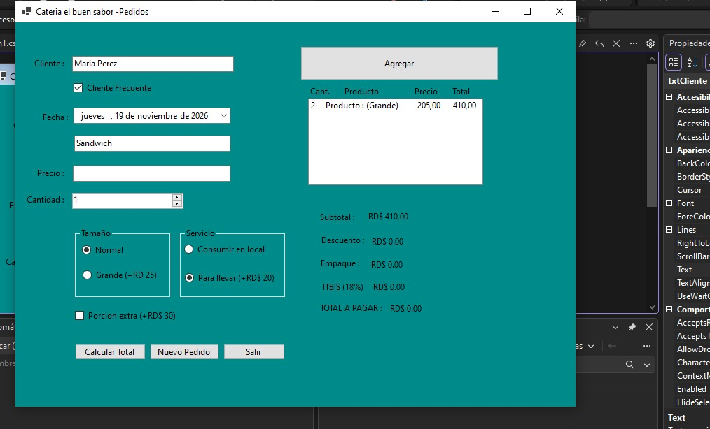
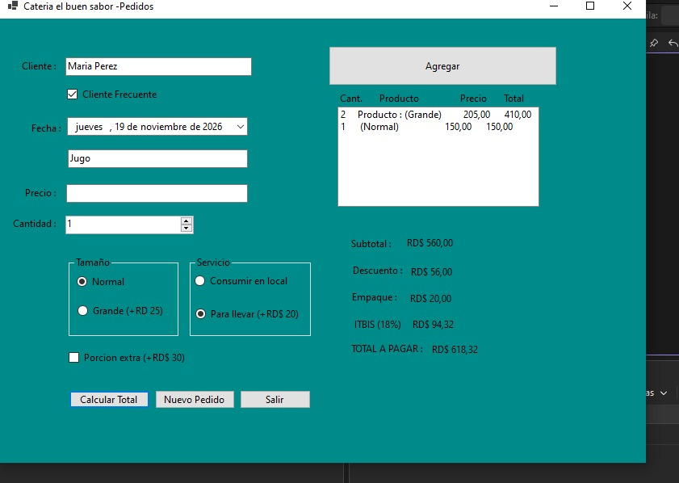

# Cafetería El Buen Sabor

## Información del estudiante

- **Nombre:** Orianna Dayanara Calcaño Reyes
- **Matrícula:** 2025-2695

---

## Descripción del programa

Este programa permite registrar y calcular pedidos de una cafetería. El usuario puede agregar productos, indicar sus precios y cantidades, seleccionar el tamaño, agregar porciones extras y elegir el tipo de servicio. También calcula automáticamente el subtotal, los descuentos, el empaque, el ITBIS y el total a pagar.

---

## Datos de entrada

- Nombre del cliente.
- Fecha del pedido.
- Producto.
- Precio del producto.
- Cantidad.
- Tamaño del producto (normal o grande).
- Porción extra.
- Cliente frecuente.
- Tipo de servicio (local o para llevar).

---

## Proceso

1. Se ingresan los datos del cliente.
2. Se selecciona el producto y se introduce su precio.
3. Se indica la cantidad del producto.
4. Se selecciona el tamaño y si desea porción extra.
5. Se agrega el producto a la lista del pedido.
6. El programa calcula el subtotal.
7. Si el cliente es frecuente, aplica un descuento del 10%.
8. Si el pedido es para llevar, agrega RD$20 de empaque.
9. Calcula el ITBIS del 18%.
10. Muestra el total a pagar.

---

## Datos de salida

- Lista de productos agregados.
- Cantidad de productos.
- Precio de cada producto.
- Subtotal.
- Descuento aplicado.
- Costo de empaque.
- ITBIS.
- Total a pagar.

---

## Imágenes del programa

### Primera imagen

### Segunda imagen

---

## Herramientas utilizadas

- **Lenguaje de programación:** C#
- **Entorno de desarrollo:** Visual Studio
- **Aplicación:** Windows Forms
